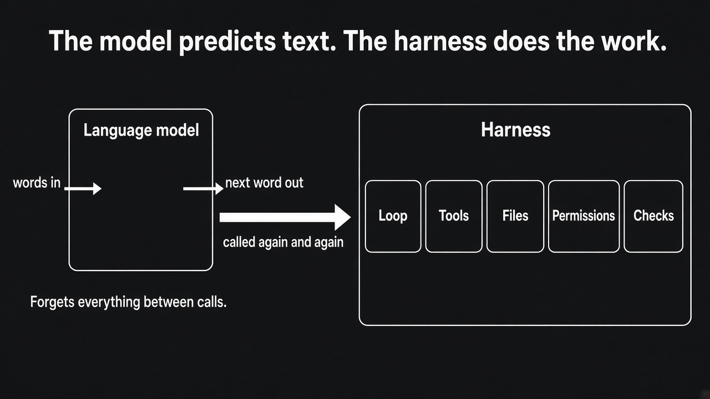
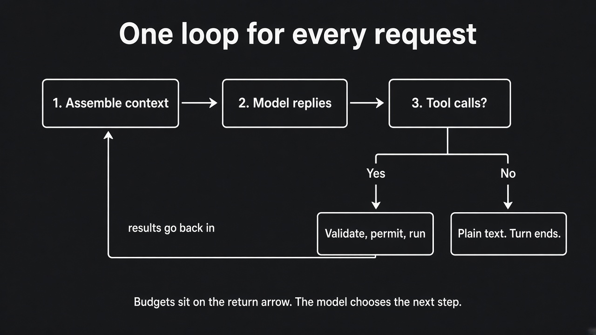
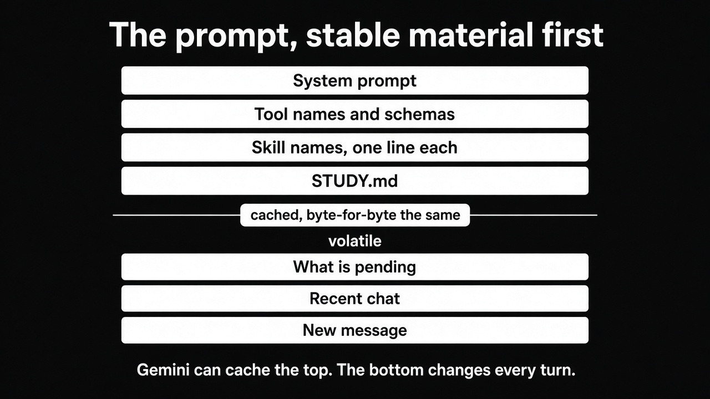
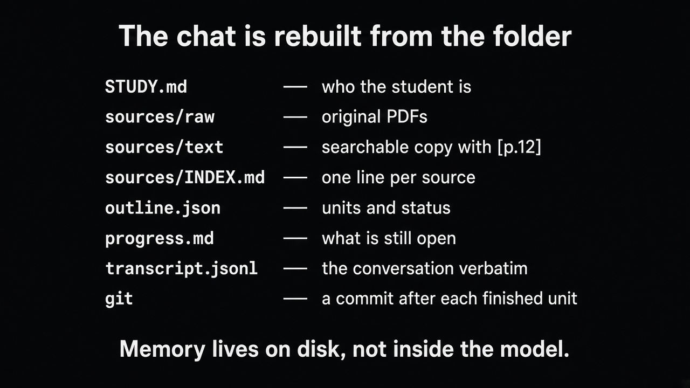
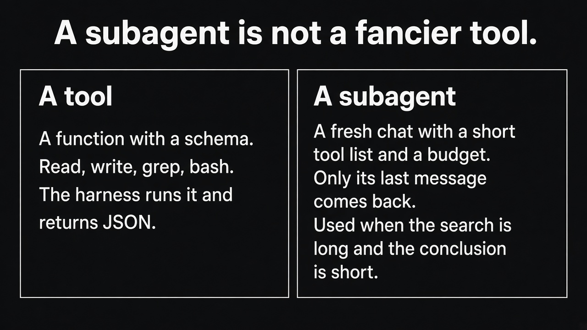
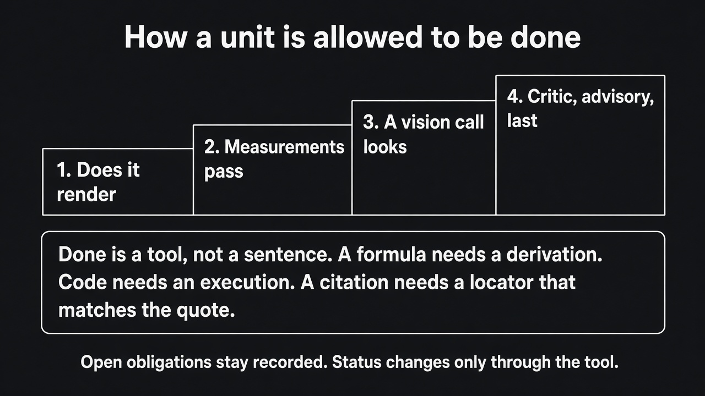
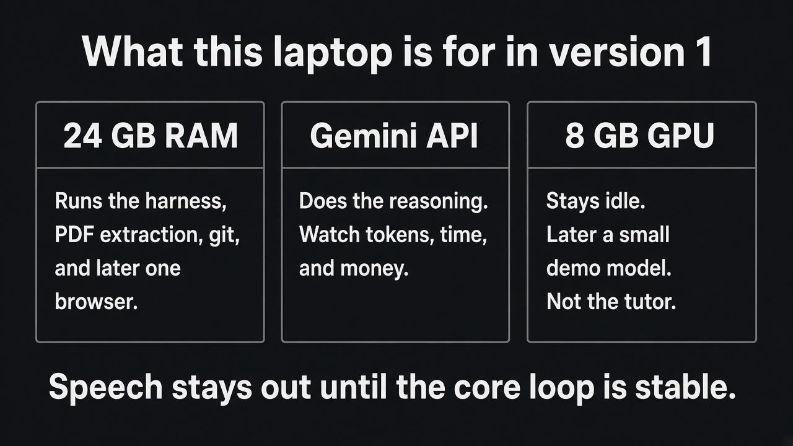
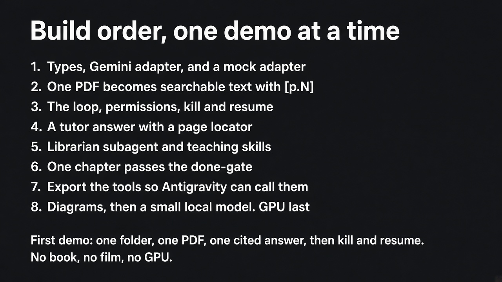

# Call with Adi: what I am being asked to build

A 30-minute discussion guide. Speak the sections marked **Say this**. Use the notes when he interrupts. The diagrams are in this same folder.

This is a comprehension check, not a pitch. The goal of the call is to say back the assignment clearly enough that Adi can correct the picture.

---

## What this call is

For two weeks the assignment has been a set of documents. Adi asked for a 30-minute call in which you explain what he actually wants you to build.

Four documents are in play. They are not four versions of the same plan.

| Document | What it is | How to use it on the call |
|---|---|---|
| The lecture for Adi | The assignment brief for this laptop: what v1 is, in what order, and what the first demo is | This is the picture you explain |
| Harness Engineering Primer | The course behind the brief. Every chapter is problem, naive version, how that fails, the version that works, and a rule of thumb | Use it when he asks why |
| Edgent plan | The full product: a desktop education harness, roadmap M0 to M8 | The lecture is the first slice of this plan, not the whole product |
| General-purpose harness tutorial | An older blueprint: Qwen on a Colab H100, a planner, embeddings, task profiles | Do not present this as the assignment. Say what it got right and what leaves |

Open with one sentence, then walk the lecture's clock. Leave the last two minutes for him to correct you.

**Say this, then stop and let him react.**

> Adi, what I think you want is a general-purpose agent harness, the same class as Antigravity, Claude Code, and Gemini CLI. One person, this laptop, one API key. I wire the tools and the limits. The model decides the steps. The education layer sits on top of that same loop. It does not become a second product. I want you to stop me where that picture is wrong.

If he says that sentence is right, continue. If he corrects it, write the correction down before you go on. That correction is the point of the call.

---

## 0:00 to 4:00. What I am building

**Say this.**

A language model is a function. Words in, next word out. Between calls it remembers nothing. It cannot open a file, run a test, or check that a citation is real. The harness is the machine around that function: the loop, the tools, the files, the permissions, and the checks.

The primer's line for this is: the model is the engine, the harness is the intelligence multiplier. Most of what makes it good is not clever. It is a few hundred small decisions, each checked against an evaluation.

The product is general purpose first. The same loop can write code, scrape a page, draft a chapter, or render a film, because those are tools the model chooses. Study files, skills, and checks are how that same agent becomes a tutor. They never narrow what the agent is allowed to be asked.

I build it in the order the plan already wrote down.

1. Types, a Gemini adapter, and a mock adapter that runs with the network off.
2. A workspace where one PDF becomes text I can search, with page markers.
3. The loop, with permissions and a session on disk.
4. A tutor answer that cites a page, and says so when the sources do not cover the question.
5. Skills, and one librarian subagent.
6. One chapter that can pass a done-gate. I cannot flip the status by editing the JSON.
7. The same tools exported so Antigravity can call them.
8. Diagrams, then a film toolchain, then a small model on the GPU. The GPU is last.

The shift I am keeping: if the scraper returns an error, the model reads that error and chooses the next call. I do not write a new pipeline for each kind of request.

**Point at the picture and say:** the left box forgets. The right box is what I am actually building.

**Study note, do not read this aloud unless he asks.** The primer splits that right-hand box into four layers.

| Layer | The question it answers |
|---|---|
| Loop and context | What does the model see, and what happens with what it says? |
| Tools and state | What can it do, and where does the result live? |
| Safety and durability | What may it do, and what survives a crash? |
| Trust | How do we know the work is right, and how do we get better? |

The Edgent plan compresses the same idea into twelve principles. You should be able to say them if he asks, but do not recite all twelve unless he wants the list. The ones he is most likely to test are: the model decides and the harness bounds it; state lives in files; search is grep, not embeddings; permissions are code; done means you ran the check; a confident guess is not a legal output.

---

## 4:00 to 11:00. The loop, on one example

Draw this while you talk. Left to right, then the arrow back.

**Say this.**

Take a request like "scrape the top sites on calculus and draft a hundred multiple-choice questions." I do not build a scraper-agent and a quiz-agent. There is one loop.

Each turn I assemble a prompt. Stable material first, so Gemini can cache it. System prompt. Tool names and schemas. Skill names, one line each. STUDY.md. Then the volatile part: what is pending, the recent chat, and the new message. Nothing that changes every call sits in the cached top.

The model has two legal replies.

- Plain text. The turn is over. I wait.
- Tool calls. I validate them, check permission, run the ones that do not depend on each other together, append the results, and call the model again.

On that calculus request the model might rewrite the query, call the scraper, read the pages, write the items, and run the key check. That sequence is its plan, revised after each result. If the scraper fails, the error comes back as data: a code, whether it is retryable, what to do instead, and any partial output that survived. The model decides. I do not hard-code "on error, retry."

Three things live in code, because a sentence in the prompt cannot enforce them.

1. Plain text ends the turn. The model cannot keep the loop alive by saying "continue."
2. Budgets. Tokens, tool calls, wall clock, and money on the Gemini key. When a budget runs out, the turn stops and a partial result is written to progress.md. The process does not vanish.
3. Tool calls that do not depend on each other run together.

There is no classifier and no planner stage in front of this loop. If I want a plan, the model writes a todo file inside the loop and revises it when a tool result surprises it. A plan written before any evidence cannot do that.

**If he asks why there is no planner.** Say: a planner that runs first locks a graph before any evidence. The todo inside the loop can change after the tool result. That is the whole reason.

**Study note.** This is the point where the older tutorial is a different design. That tutorial puts a task router, a plan-and-execute stage, and tree-of-thought branching in front of the work. The Edgent plan looks at the current repository, which was built that way, and says the upfront DAG, the classifier, and the planner are the wrong spine for this assignment. About a thousand lines solving a problem the loop does not have. If Adi mentions the Fareed article or the Colab tutorial, this is the sentence.

---

## 11:00 to 17:00. Tools, files, and search

**Say this.**

Tools are few and general. The core set is the one a coding agent needs: read a file, write a file, exact-string edit, bash, glob, grep, web fetch, web search, spawn a subagent, load a skill, ask the user, and a todo list.

A scraper is a Python function behind one of those, or its own tool only when bash plus a skill would be slower or unsafe. I add a tool when I can name the question it answers, and I add its contract test in the same change.

Every call goes through one registry. The registry checks the JSON schema, the permission class, the timeout, and whether this exact side effect already ran. A big result is written to a file. The model sees a short preview and a path. Errors are JSON, not a Python traceback. A render that finished 18 beats out of 20 returns those 18 beats and one error, and the message tells the model not to repeat the unchanged call.

State is the workspace directory. The chat is a view of that directory, rebuilt every call. The model does not hold the session. The disk does.

| File | What it holds |
|---|---|
| STUDY.md | Who the learner is, level, language, what never to do. Loaded every call. |
| sources/raw/ | The PDFs and notes, left as originals. |
| sources/text/ | The searchable copy. A PDF page is marked [p.12]. A transcript moment is marked [t=00:14:32]. |
| sources/INDEX.md | One line per source: what it is, where the text view is, what was covered. |
| outline.json | Every chapter, film, and exercise, each with a status. Entries are not deleted. |
| progress.md | Append-only. What the last session did and what it left open. |
| transcript.jsonl | The conversation, verbatim, written as it happens. |
| knowledge/house.md | Preferences, rewritten as a whole, size-capped. |
| git | A commit after each finished unit. A fresh session reads git log. |

The full Edgent workspace is larger than this picture. It also has book chapters, films, assessments, a learner model, an evidence folder, and an unknowns file. For v1 I am not building that whole tree. I am building the part the first demo needs: STUDY.md, one ingested PDF, the index, the transcript, and progress.

Search is grep. Ingest turns a PDF into Markdown with page markers and records which pages extracted and which failed. A grep miss on a failed page is unknown. The model says so. It does not say "the book never mentions this."

For a broad question, a librarian subagent gets a fresh context, grep and read only, and returns a handful of quotes with locators. The main chat pays for the conclusion. It does not pay for the twenty files the librarian opened.

Embeddings are out of this design. The plan says so, and the 8 GB card should stay free for the later module. If paraphrase questions fail on a measured set, the next step is a keyword index in SQLite. Still no vectors.

Skills are the pedagogy. SKILL.md files: how to explain, how to write a chapter, how to tutor, how to write a question. The prompt always carries the name and one line. The body loads when the model asks for it. Improving how it teaches is a Markdown edit, not a code change.

When the window fills, cheapest loss first. Old tool results become one-line pointers to the file. Then the oldest block of turns becomes a note: what was asked, what was decided, what is still open, which paths matter. Notes roll up so they grow with the log of the chat, not with its length. The full transcript stays on disk. A recall tool greps it and returns the old exchange word for word. Notes are written to disk before the next Gemini call. A crash loses the in-flight call, not the session.

**If he asks why grep, when the Fareed article used embeddings.** Say: the corpus is text I control, with locators. Grep plus reading around the hit is how a coding agent finds a function. A citation has to resolve mechanically. I will measure paraphrase questions. SQLite full-text is the upgrade if grep loses. Vectors are a different system, and this design leaves them out.

---

## 17:00 to 22:00. Safety, proof, and long jobs

**Say this.**

Permissions are a class on every tool: read, compute, write, network, spawn, interactive, delete. The modes are ask, accept edits, auto inside the workspace, and plan, which is read-only. Network and delete still ask even in auto. Allow and deny lists live in a settings file. Your yes or no is enforced by the registry. It is not a suggestion passed back to the model.

Anything from a PDF, a web page, OCR, or a transcript is data. It is labelled as data. Text inside it cannot change a permission. Model-written code runs in a sandbox: resource limits, a scrubbed environment, and a directory it cannot escape.

"Done" is a tool, not a sentence. For a chapter, the tool derives what is still owed. A formula owes a derivation. A code block owes an execution. A citation owes a locator that resolves to the quoted text. The model's opinion does not close "the code runs." Only the execution does. Open obligations become a recorded unknown, and the unit stays partial. Status moves only through that tool. Entries in outline.json are not deleted.

The order of proof is cheapest and most objective first: does it render, do the measurements pass, has a vision-capable call looked at the output, then a critic with none of the author's context. The critic is advisory and last.

A long book is many sessions, and it is not the first demo. When that work starts, an initializer session writes the full unit list, all pending, and progress.md. Each worker session takes one unit, with a fresh context, reads the progress tail and git log, builds, runs the gate, commits, and appends progress. A crash resumes from the outline and git. Side effects are keyed, so a resumed run does not send or render the same thing twice.

The test I will put in CI is: kill the process at a random point, resume, and check that the result matches and no side effect ran twice.

**If he asks what the epistemic cue is.** Say: when no check can prove the answer, the reply says it is unverified. A confident guess is not a legal output.

**Study note.** The older design had a trust gate that rewrites an answer into a failure report. The plan drops that gate from the spine. Checks become tools the agent calls. The only gate is on mark_done. Education output is reviewed by a person. Verification should be an artifact the person can see, not a rewrite of the answer.

---

## 22:00 to 28:00. This laptop, and the order I will code

**Say this.**

Gemini API is the driver. I already have a key. The loop does not mention Gemini by name. It sees a capability record: native tool calls, a system channel, images, a context size, a thinking budget, a concurrency limit. A mock provider implements the same record and returns scripted tool calls, so I can test the loop with the network off. When a local model exists later, it is another class behind that record. The loop stays.

- The 24 GB of RAM runs the harness, PDF extraction, git, and later one browser.
- The Gemini key does the reasoning. I watch the budget so a long session does not burn the key.
- The 8 GB GPU stays idle in v1. A 7B model at 4-bit can fit later, with a short context, as a demonstration that the provider port is real. It is the last module. It is not the tutor.

Speech stays out until the core is stable. Text, images, and frames from video are in.

The code layout is strict. Python 3.11, uv, ruff, pytest. Domain types import nothing of ours. The loop imports the domain. Adapters import both. The loop never imports the Gemini SDK. The adapter does.

I will write each module, read it back, and explain the file before I add the next one.

**Study note, so you do not mix up two roadmaps.** The lecture's eight demos are a narrowed cut of the Edgent plan's M0 to M8. If he uses milestone numbers, translate.

| Lecture demo | Plan milestone | What "finished" means |
|---|---|---|
| 1. Types, Gemini adapter, mock | M0, without treating the bridges as the first demo | The same contract tests pass for both adapters |
| 2. One PDF becomes searchable text | A small M1 | [p.N] markers, an index line, a citation check returns the surrounding text |
| 3. Loop, permissions, kill and resume | M2 | A few hundred scripted turns stay inside the budget. Kill it, resume, recall one early sentence verbatim |
| 4. Tutor on the real course PDFs | The tutor half of M2 | An answer with a locator, or an honest "the sources do not cover this" |
| 5. Librarian and teaching skills | Part of M4 | The main chat pays for the conclusion |
| 6. One chapter through the done-gate | A small M5, one unit, not a 100-page book | Editing outline.json cannot flip the status |
| 7. Export the tools over MCP | M3 in the plan, placed later in the lecture | Antigravity can drive a session with these tools |
| 8. Diagrams, Manim, then a local model | M6, and the GPU demo the plan does not treat as the tutor | Only if a doctor command reports the toolchain. GPU last |

One wording difference you should raise yourself, not discover mid-sentence. The Edgent plan has a sentence that calls host mode the right first deliverable: Antigravity runs the loop, and my tools are what it calls. The numbered roadmap still builds our own loop at M2 and the MCP export at M3, and it says M3 comes before long builds. The lecture picks a side: version 1 is my own loop talking to Gemini, with a mock beside it. Host mode is later. I do not start by wrapping `agy --print`, because that path has a prompt ceiling of about 128 KB, it can truncate silently and still report success, and it has no native tool channel. I would be debugging two products at once.

Say that difference out loud and ask him which sentence wins.

---

## 28:00 to 30:00. What I will show first, and what I need from you

**Say this.**

After you tell me this picture is right, the first demo is small. A folder. One PDF. One question. An answer that cites something like source:p.12. The process killed in the middle of the loop. A resume that continues from the transcript on disk. No book, no film, no GPU.

What I need from you on this call is to correct the picture where I have it wrong. Especially two decisions: Gemini API first, with a mock beside it, and leaving the 8 GB card until the loop, the files, and the done-gate are real.

Then stop talking.

---

## If he interrupts

Answer in one breath, then ask if he wants the longer version. These are the questions the lecture expects.

**Why is there no planner in front of the loop?**
The model writes and revises a todo inside the loop, after it has seen tool results. A planner that runs first locks a graph before any evidence.

**Why grep, when the other articles used embeddings?**
The corpus is text I control, and every hit has a locator. I will measure paraphrase questions. If grep loses, SQLite full-text is next. Vectors are a different system.

**What did the old harness get right, and what leaves?**
The tool registry, the sandbox, the OpenAI-compatible client, and the mock model stay. The upfront DAG, the trust gate that rewrites an answer into a failure, the pile of narrow tools, and BM25 leave the spine. Checks become tools the agent calls. A gate exists only on mark_done. The Colab launcher leaves too. This laptop is the machine, not a Colab session.

**How is a subagent different from a tool?**
A tool is a function with a schema. A subagent is a fresh chat with a short tool list and a budget. Only its last message returns. I use one when the search is long and the conclusion is short.

**What is host mode, since the brief chooses the Gemini API?**
My own loop talks to Gemini. That is v1. Host mode is later: Antigravity runs its loop, and my tools and skills are what it calls. The tool layer is the part that survives either driver. I build that layer so both can use it. I do not start by wrapping `agy --print`.

**How do I know a change helped?**
A golden task per capability: ingest, cite, recall, one chapter. Score the first tool, repeated identical calls, schema failures, and whether the required checks ran. Tokens and time go in a table. A layer that does not move the numbers comes out.

**Can the 8 GB card run the tutor?**
It can run a small quantized model for a later swap-the-provider demo. It cannot host the model that should write a book or judge a chapter. Those calls go to Gemini.

**What is the epistemic cue?**
When no check can prove the answer, the reply says it is unverified. A confident guess is not a legal output.

**What is a skill, in one sentence?**
A Markdown file the model can ask to load. The prompt only carries the name and one line until then. Teaching quality changes by editing that file.

**What survives a crash?**
The transcript, the notes, the outline, and git. Side effects are keyed, so resume does not do the same thing twice. The test is to kill the process at a random point.

---

## What not to claim on this call

These are real ideas in the documents. They are not what v1 is.

- Do not say you are serving Qwen 3.8 27B on a Colab H100. That is the older tutorial. The assignment machine is this laptop, and the reasoning is the Gemini API.
- Do not say embeddings, a vector store, or BM25 are part of the design. The plan rules them out.
- Do not describe a classifier, a DAG planner, or tree-of-thought as the control flow. The control flow is the loop.
- Do not say a second model reviews the answer and, if it disagrees, the harness rewrites the answer into a failure. The critic is advisory and last. The gate is mark_done.
- Do not promise a book, a film, speech, or a local tutor model in the first demo.
- Do not say you will start by wrapping `agy --print`.

What you can honestly say you are taking from the older work: the registry, the sandbox, the mock client, ingestion into text with locators, and the habit of tracing tokens and failures. The primer also keeps a narrow use of sampling: self-consistency only when answers can be compared, such as numbers or short choices, and a critic for free text. That is not the spine.

---

## A one-page map of the assignment

You are building Edgent's spine on this laptop, in this order.

**The engine.** A provider port. Gemini on one side, a mock on the other. The loop never imports the Gemini SDK.

**The memory.** A folder. One PDF becomes sources/text with page markers. The conversation is a JSONL file. Git is the checkpoint.

**The loop.** Assemble context, call the model, run tools or stop. Budgets and permissions are code. Plain text ends the turn.

**The tutor slice.** Answer from those pages with a locator you can check. Say when the sources do not cover the question.

**The proof slice.** One chapter. Status changes only through a tool that ran the checks.

**Later, and not on this call's demo.** Librarian and skills in full, MCP so Antigravity can drive the tools, diagrams and Manim, a small local model on the idle GPU.

The first thing Adi should be able to watch: folder, one PDF, one question, a citation, kill, resume.

---

## Glossary you should be able to say out loud

**Harness.** Everything around the model that lets it do real work: loop, tools, files, permissions, checks.

**Turn.** One user request, followed by as many model-and-tool rounds as it takes, until the model replies with plain text or a budget runs out.

**Tool.** A function with a name, a JSON schema, a permission class, and a result the model can read.

**Registry.** The one function every tool call passes through. It validates, checks permission, times out, skips a repeated side effect, and compacts a huge result.

**Capability record.** The list of facts the loop is allowed to know about a provider. Native tools or not, images or not, context size, thinking budget, concurrency. No vendor name in the loop.

**Cache prefix.** The top of the prompt that stays byte-for-byte the same all session, so the provider does not reprocess it.

**Compaction.** Throwing away the cheapest context first: old tool output becomes a pointer, old turns become a note. The full transcript stays on disk.

**Recall.** A tool that greps the transcript and returns an old exchange word for word.

**Skill.** Instructions in Markdown, loaded only when the model asks. The pedagogy lives here.

**Subagent.** A fresh chat with a short tool list and a budget. Only the last message comes back.

**Librarian.** The subagent that searches sources and returns quotes with locators. It does not answer the question itself.

**Host mode.** A later driver. Antigravity or Claude runs the loop. Your tools and skills are what it calls, over MCP.

**Bridge mode.** Using `agy --print` as a bare text completion behind your own loop. The lecture says not to start here.

**Done-gate.** The tool that runs the checks and is the only way a unit's status moves. The model cannot flip the JSON by hand.

**Obligation.** Something a unit owes before it can be done: a derivation, an execution, a citation that resolves. An open obligation makes the unit partial.

**Epistemic cue.** The required phrase when nothing can prove the answer: unverified.

**Golden task.** A fixed example for one capability, scored the same way every time, so a change can be seen to help or not.

---

## Check yourself before the call

Answer these out loud, without the notes. The answers are underneath.

1. What does the model remember between calls?
2. What are the only two legal shapes of a model reply?
3. Why does stable text go at the top of the prompt?
4. Name the three rules the loop enforces in code.
5. Where does the session live after a crash?
6. What is a citation, mechanically?
7. What closes the claim "the code runs"?
8. What is the first demo, in one sentence?
9. What stays idle in v1, and why?
10. What will you ask Adi to correct?

**Answers.**

1. Nothing. Memory is the folder, the transcript, and git.
2. Plain text, which ends the turn, or tool calls, which the harness runs and then calls the model again.
3. So the provider can cache it. Anything volatile near the top breaks the cache and costs money and latency on every call.
4. Plain text ends the turn. Budgets stop the turn with a partial note. Independent tool calls run together.
5. transcript.jsonl, the notes written before the next call, outline.json, progress.md, and git. The in-flight call can be lost. The session cannot.
6. A locator such as source:p.12 that a tool resolves to the text around that marker. If the page failed extraction, the honest result is unknown.
7. An execution. A model's opinion does not close it.
8. One folder, one PDF, one question, an answer that cites a page, the process killed mid-loop, and a resume from the transcript. No book, no film, no GPU.
9. The 8 GB GPU. A small model can fit later as a provider-swap demo. It is not the tutor. The tutor calls go to Gemini.
10. The provider choice, Gemini with a mock beside it, and the decision to leave the GPU until the loop, the files, and the done-gate are real. Also which sentence wins on host mode: own loop first, as the lecture says, or host mode as the first deliverable, as one paragraph of the plan says.

---

## How to spend the hour before the call

Read this guide once aloud, with a clock, and stop at each pause. If the speaking sections run past 22 minutes, cut study notes, not the loop and not the first demo.

Then close the notes and answer the ten questions. If you miss one, that is the page to reread.

Have the loop diagram in front of you. Draw it while you talk, the way the lecture asks. The drawing is part of the assignment, not decoration.

Take a pen for his corrections. The last two minutes belong to him.
